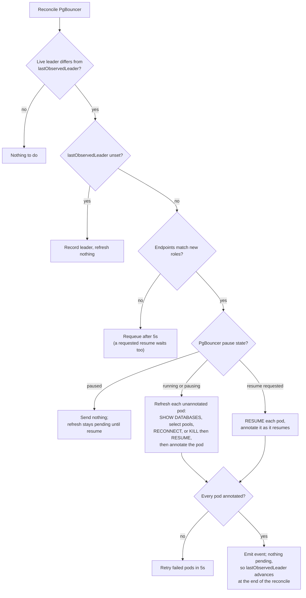

# PgBouncer pool refresh on leader change

## Summary

When PgBouncer has a separate read pool, as described in [Configure separate read and write pools](https://docs.percona.com/percona-operator-for-postgresql/latest/expose.html#configure-separate-read-and-write-pools), a switchover or failover can leave that pool's existing connections on the new primary. Promoting a standby doesn't restart PostgreSQL, so the server connections PgBouncer holds through a read pool on `<cluster>-replicas` stay open. Read queries on those connections keep running on the new primary and compete with writes for CPU and I/O. When the Services change, Kubernetes sends new connections to the right pod, but established connections stay where they are.

With this changes described in this document, the operator refreshes selected PgBouncer pools after a leader change, so each pool goes back to a backend with its intended role. Users choose the pools. For each pool they also choose whether in-flight work may be interrupted. The commands go through the PgBouncer admin console, which the operator already uses for `spec.proxy.pgBouncer.paused`.

## Goals

- After a leader change, selected pools end up on a backend with their intended role.
- Users choose which pools are refreshed, and whether in-flight work may be interrupted.
- Works without extra configuration for the common setup.
- Opt-in. Existing clusters behave exactly as today.
- A refresh survives operator restarts and runs at most once per leader change.
- Never undoes a pause the user set.

## Non-Goals

- Terminating connections on the PostgreSQL side. Connections that bypass PgBouncer are out of scope.
- Per-user refresh within a database.
- Scheduling or delaying the refresh.
- Detecting stale connections continuously, outside of leader changes.

## Design

The refresh is a new step in the operator's PgBouncer reconcile. It runs once the Services point at the new roles, and sends PgBouncer admin commands to every PgBouncer pod.



### API

A new optional field on `spec.proxy.pgBouncer`:

```yaml
spec:
  proxy:
    pgBouncer:
      refreshOnLeaderChange:
        mode: Graceful            # Graceful | Immediate
        pools:                    # optional
        - name: analytics         # read pool: let queries finish
        - name: "*"               # every other pool
          mode: Immediate
```

- **No field:** the feature is off.
- **`mode`:** the default for every refreshed pool. Each pool can override it.
- **`pools`:** which pools to refresh, by the database name clients connect to. `*` matches every pool not listed by name.

A new status field records the last leader the operator has fully handled:

```yaml
status:
  lastObservedLeader:
    podName: cluster1-instance1-abcd-0
    transitions: 3
```

Both values come from the leader lock Patroni keeps as annotations on the `<cluster>-ha` Endpoints. `podName` is the `leader` annotation. `transitions` is a counter Patroni increments each time a different pod takes the lock. With the counter, a leader that moves away and back between two reconciles (A→B→A) still counts as a change. If the annotation is missing or isn't a number, the operator uses 0, which is what Patroni does.

At the start of each reconcile, the operator compares the live leader with `lastObservedLeader`, field by field. If either field differs, a refresh is due. Checking `podName` as well covers the counter restarting from 0 if the Endpoints object is ever recreated. An unset `lastObservedLeader` means the operator hasn't seen a leader for this cluster yet. The field is updated at the very end of the reconcile, and only when no refresh is still pending. A refresh that is waiting, retrying or held by a pause therefore stays due until it finishes, including across operator restarts. When the feature is off, nothing is ever pending, so the field always follows the current leader.

While a refresh is pending, the field shows the previous leader. It is not a reliable source for the current primary.

### Selecting pools

The operator selects pools from PgBouncer's live pool list (`SHOW DATABASES`), not from the CR. So a database served through the `*` wildcard can be listed by name without its own `[databases]` entry, and custom PgBouncer config files work too.

When `pools` is omitted, the operator refreshes every pool that points at the cluster's primary or replicas Service. Pools on other hosts are left alone.

### Refresh modes

| Mode | Admin commands | Effect |
| --- | --- | --- |
| `Graceful` | `RECONNECT` | Clients stay connected. Each server connection is replaced once it is released. |
| `Immediate` | `KILL`, then `RESUME` | Clients are disconnected and in-flight queries fail. |

With session pooling (PgBouncer's default), a server connection is released only when its client disconnects. So `Graceful` can leave a long session in place until it ends. Users can set `server_fast_close` to release connections at the end of the current transaction instead.

### When the refresh runs

The operator detects a leader change when the `leader` and `transitions` annotations on `<cluster>-ha` no longer match `status.lastObservedLeader`. It waits until the primary and replicas Endpoints reflect the new roles, then refreshes. Refreshing earlier could reconnect PgBouncer to the wrong pod. The design assumes Endpoints are accurate once updated.

The first time the operator sees a cluster, it records the current leader without refreshing, so turning the feature on never disconnects anyone.

### Tracking progress

Each PgBouncer pod gets an annotation, `pgv2.percona.com/pgbouncer-refreshed-leader`, recording the leader it was last refreshed for as `<podName>/<transitions>`. A retry after a partial failure then refreshes only the pods that failed. When every pod is done, the operator emits an event and reports nothing pending, so `status.lastObservedLeader` advances at the end of the reconcile.

### Interaction with pause

| PgBouncer state | What the refresh does |
| --- | --- |
| Running | Normal refresh |
| Pausing (pause requested, not finished) | Normal refresh. This also ends sessions holding up the pause. |
| Paused | Nothing. A paused PgBouncer holds no server connections. The refresh waits for the resume. |
| Resume requested | The operator holds `RESUME` until the Endpoints reflect the new roles. Every connection opened after that is new and on the right pod, so no further refresh is needed. |

The operator never sends a global `RESUME` that would undo a user's pause.

### Why the operator runs the refresh

The other option was a Patroni `on_role_change` callback: a script that Patroni runs in the database pod whenever that pod's role changes. The script would connect to each PgBouncer pod and send the same admin commands.

We chose the operator. The refresh has to wait for the Endpoints, retry failures, respect the user's pause, and follow the pools and modes in the CR. The operator already has the state, credentials and network access for all of that. A callback would need all of it moved into the database pods.

| | Operator | Patroni callback |
| --- | --- | --- |
| **Speed** | Runs on the next reconcile after the change, usually within seconds | Runs the moment the role changes |
| **Operator down** | The refresh waits until the operator is back | Still runs |
| **Timing** | Waits until the Endpoints reflect the new roles | Fires on the role change, which can come before the Endpoints update. The script would need its own waiting. |
| **Retries and progress** | Retries failed pods, survives restarts, reports status and events | Runs once and doesn't retry. A failure only shows up in the Patroni log. |
| **Pause and settings** | Reads `paused`, the pools and the modes from the CR | Needs the settings mounted into the database pods, and has no view of the pause state |
| **Credentials** | Uses the PgBouncer admin password it already holds | The admin password would have to be mounted into every database pod |
| **Finding PgBouncer pods** | Already lists them for the pause feature | Needs Kubernetes API access from the database pod, or a new headless Service |
| **Leader tracking** | Needs `lastObservedLeader` to detect changes | Patroni tells the script directly |

The callback's real advantages are speed and running while the operator is down. Both matter less here. The read-pool problem costs performance rather than correctness, so a few seconds' delay is acceptable. If the operator is down during a failover, the refresh still happens when it comes back.
